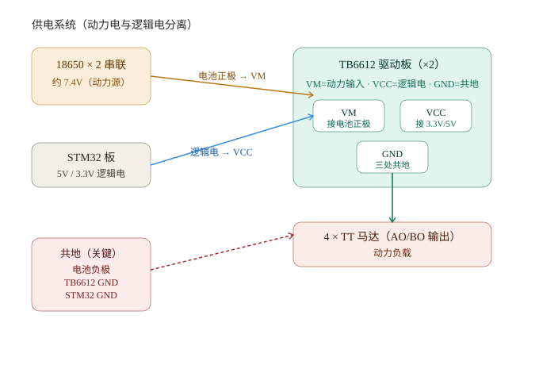
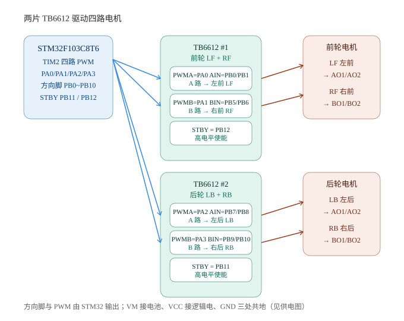
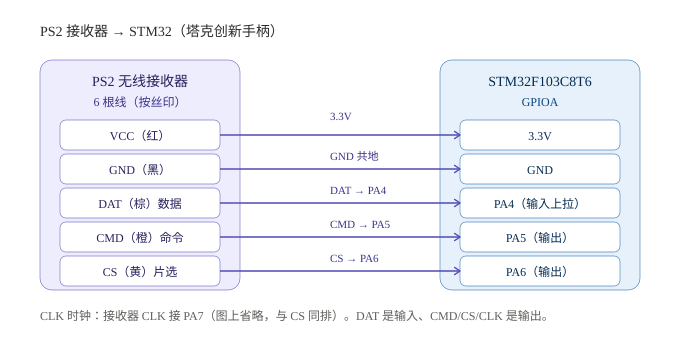
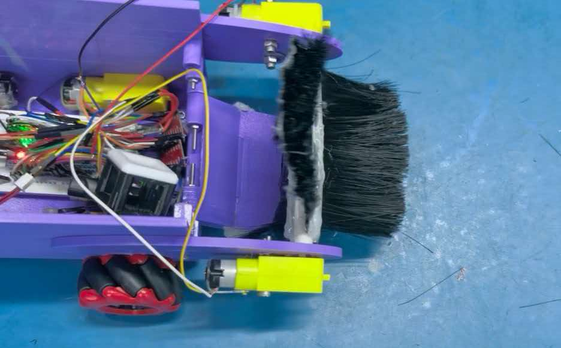
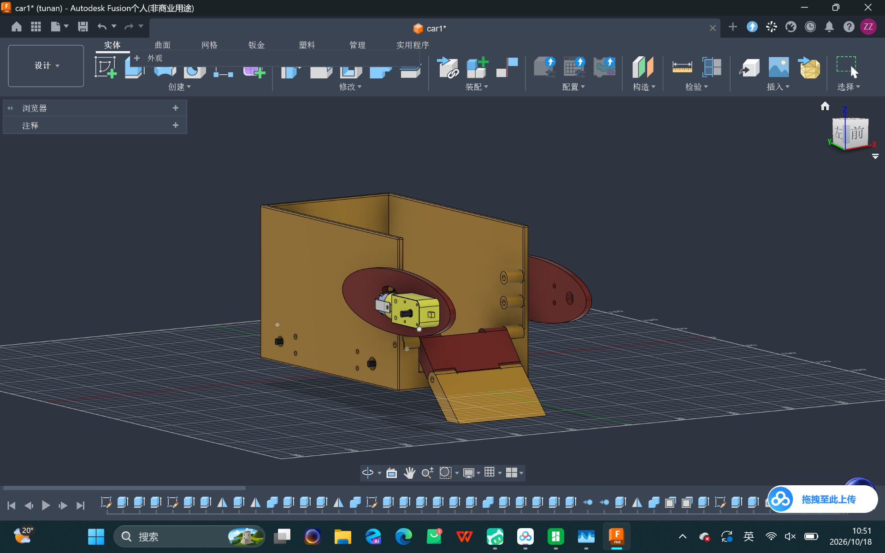
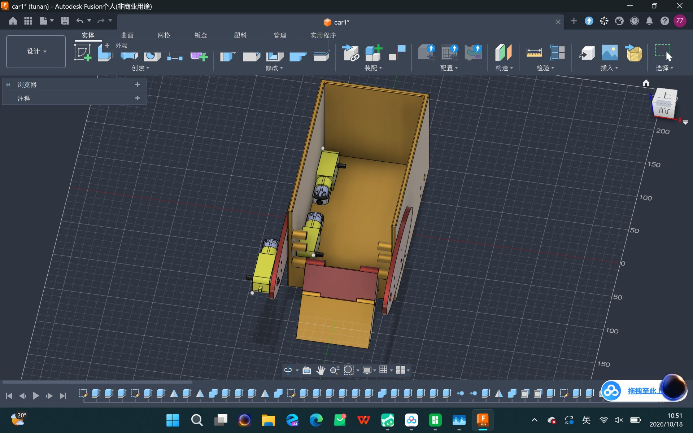
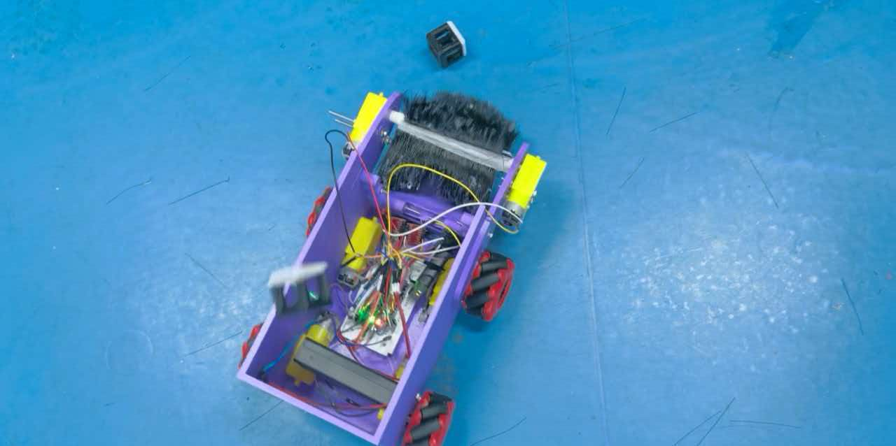
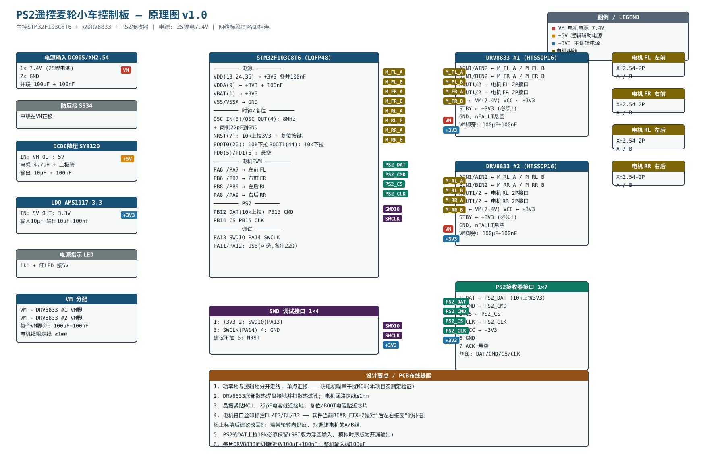
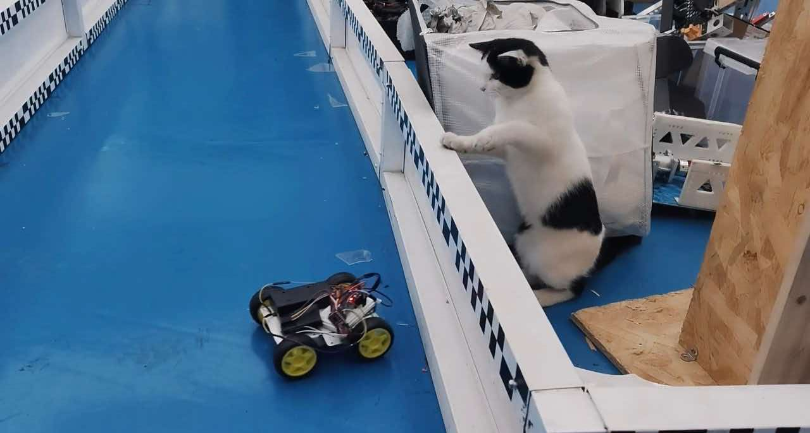

# CRTC2026 参赛札记 · Vanta 队

队伍：Vanta（新生组）  
成员：周子清（队长，机械）、田维浩（硬件·电控）、李香君（机械）、邵震硕（硬件·电控）

我们做了两台 PS2 遥控的麦轮小车。一台以 TB6612 为驱动，带 3D 打印车壳与毛刷式收集装置，是完成度最高的一台；另一台以 DRV8833 为驱动，无车壳、裸底盘，作为第二台验证与迭代平台，并自行设计了控制板 PCB。下面按制作时间线分别记录。

---

# 第一台车（TB6612，带车壳与收集装置）

这台车是团队的完成度担当：主控 STM32F103C8T6，两片 TB6612 驱动四个 TT 马达，60mm 麦轮，PS2 无线手柄遥控，两节 18650 串联 7.4V 供电。紫色 3D 打印车壳内集成毛刷式收集装置，可完成方块携带。它承担了「从零跑通」的使命，几乎所有的坑都是在这台车上先踩的。

## 起步与工具链

主控是赛题指定的 STM32F103C8T6，没什么可纠结，我们就把精力放在怎么把开发环境搭顺上。

最早按群里的教程装了 Keil MDK。能编译、能下载，但用起来确实别扭——编辑器补全弱、工程管理繁。这台车是奔着「深入底层」去的，Keil 那种黑盒式的 GUI 工程配置让我们心里没底，所以很快决定换到 VS Code + CMake + Ninja，配合 ST-Link 烧录。换过去的代价是初期配置成本高，CMake 脚本、工具链路径、头文件搜索路径，一堆细节要调；但换来的是工程文件全透明、git 友好，改什么都在自己手里。

真正把这台车推向「裸机」的是对时序的执念。HAL 库虽然快，但抽象层之下藏着很多我们控制不了的东西——PWM 的精确时序、GPIO 的翻转时机，都想拿在自己手里。于是这台车最终走成了寄存器级裸机编程：全工程只有一个 main.c，用 arm-none-eabi-gcc 14.3.1 编译，加了 `-Os -nostartfiles -nostdlib`。启动文件从 ST 官方 DFP 包里扒出来，链接脚本按 Flash 64K、RAM 20K 自己写。

裸机关掉标准库之后，第一个报错就是 `__libc_init_array` 未定义。原因是我们关了 libc，链接器却还在找它的初始化流程。解决办法是用一个空桩函数顶替它，再配合 `-nostdlib` 让链接器彻底不依赖 libc。这个坑踩完，反而把「从复位向量到 main 之间到底发生了什么」这件事彻底弄明白了——程序上电后先跑启动文件，初始化栈指针和中断向量表，再进 main，这中间没有半点魔法。

时钟这块，这台车图省事用了内部 HSI 8MHz，没开 PLL。当时觉得够用，后面电机调试的时候为此吃了亏，这是后话。

## 供电：动力与逻辑分离

供电是从这台车开始定下的原则：动力电和逻辑电必须分开。

两节 18650 串联约 7.4V，直接接到 TB6612 的 VM 脚，专供电机；逻辑侧单独 3.3V 给主控和驱动板的 VCC；电池负极、驱动板 GND、主控 GND 三处共地。为什么要分开？电机起步那一瞬间的电流很大，四个 TT 马达一起动能到安培级，如果和逻辑共用一路电，电压一跌单片机就复位了。物理上把两条回路拆开，控制电路才能在动力剧烈波动的时候稳住。



这个原则在之后两台车上都贯彻了下来，成了我们供电的底线。

## 电机驱动：TB6612 与 10kHz 的取舍

驱动芯片的选择上，L298N 是第一个被排除的。它是老的达林顿管驱动，导通压降高达 2V，发热大、效率低——7.4V 供电扣掉 2V，电机实际只能拿到 5V 出头，还白白发热。TB6612 是 MOS 管驱动，压降低、发热小、体积也小，明显更适合这种小底盘。这台车用两片 TB6612，每片双 H 桥，正好带四个电机。

接线用 TIM2 一个定时器出四路 PWM，方向脚独立接 GPIO：

- 左前 LF：PA0（PWM），PB0/PB1（方向）
- 右前 RF：PA1（PWM），PB5/PB6（方向）
- 左后 LB：PA2（PWM），PB7/PB8（方向）
- 右后 RB：PA3（PWM），PB9/PB10（方向）
- 两片 TB6612 的 STBY 分别接 PB12、PB11，都要拉高才能工作



PWM 频率上我们经历了从 1kHz 到 10kHz 的迭代。一开始定的 1kHz，电机低速的时候抖得厉害、出力也不足。把频率提到 10kHz 之后，电流连续了，低速顺滑多了。这个频率不是越高越好也不是越低越好，得在电机的电感滤波效果和开关损耗之间找一个平衡点，TT 马达用 10kHz 是舒服的区间。PWM 参数定在 PSC=0、ARR=799。

四个 TT 马达个体差异不小——换向器摩擦、绕组参数都不太一样，直接给一样的 PWM，四轮转速不一致，车就跑偏。所以后来加了两层补偿：一是起步补偿，PWM_MIN=200，让电机先越过静摩擦那个死区；二是轮速标定，g_cal={1000,1200,1200,1200}，以左前轮为基准，把另外三个轮的系数补上去。

麦轮的运动学解算用的是标准合成公式，设车体速度 vx（前后）、vy（左右）、wz（旋转）：

```
lf = vx + vy + wz
rf = vx - vy - wz
lb = vx - vy + wz
rb = vx + vy - wz
```

这里有个细节花了不少心思：解算完要做等比例限幅。如果某个轮子的速度超了 PWM 满量程，不能单独把它压下去——那样四个轮子的速度比例就被破坏了，车的实际方向会偏离手柄的指向。正确的做法是四个轮子一起等比缩小，牺牲一点速度，保住方向。这个细节看似小，直接决定了全向移动的手感对不对。

## 遥控：PS2 的接入

遥控是这台车最后打通的一环，也是「从能动到能按指令走」的关键。

PS2 接收器接在 PA4~7，DAT 是输入上拉，CMD、CS、CLK 是输出。协议是 8bit 串行、LSB first，支持数字（0x41）、模拟（0x73/0x53）、红绿灯（0x79）三种模式，摇杆字节 raw[5]=右X、raw[7]=左X、raw[8]=左Y。



断连排查我们总结成三步：先查引脚有没有错位，再看位序是不是 LSB，最后看数字/模拟模式对不对。这三步过一遍，基本就能定位问题。

这台车最终实现了前进、后退、横移、原地旋转的全向移动，电机与底盘运动的所有指标在这台车上全部通过。



## 车壳与收集装置

这台车有紫色 3D 打印车壳，也是两台中唯一集成了收集装置的一台。收集方案定为毛刷滚筒式：一个电机带动毛刷旋转，把地面上的方块扫进车舱，舱体围板兜住就完成了「携带」。工作流程是车头倾斜引入板引导方块滑入毛刷区，旋转毛刷把它拨过坡道扫进舱里，围板形成的空间让方块在行驶中不会掉出。

毛刷方案较夹爪、铲斗的取舍在于容错性：夹爪需多关节加舵机、控制复杂且夹持 30mm 小方块成功率低；铲斗依赖精确对位、方块稍偏即失效。毛刷对对准精度要求最低，方块大致靠近引入板即可被扫入，符合新生组时间与对位精度有限的现实，是最务实的方案。







车舱做成箱式，容量能同时装下两块以上的方块，所以携带单一（收一块）和携带多项（带着一块再收一块）都能做到，两块同时在舱里不打架、行驶不掉，实测是通过的。

# 第二台车（DRV8833，无车壳裸底盘）

第二台车在驱动芯片上换成了 DRV8833，主控还是 STM32F103C8T6，电机、麦轮、PS2、供电结构基本沿用第一台车的成熟方案。这台车没有装车壳，也没有收集装置——它的定位很明确：不带机械负担，专注验证控制方案、打磨驱动细节，并完成自制控制板 PCB。时间线也更密集，踩了一些第一台车没遇到的新坑。

## 10 月 12 日：单电机最小系统

起步依旧是先把单电机跑通。用的是 PA6/PA7，TIM3 的两个通道。这一步的目标很明确：验证主控、驱动、电机、电源这条最小链路的完整性，确认最基本的 PWM 能带起一个电机。

## 10 月 13 日：时钟修正与 PWM 定稿

这一天做了一件影响深远的事：把系统时钟从内部 HSI 换到了 HSE + PLL，跑到 72MHz。这个改动直接解决了一个悬而未决的问题——PWM 的实际频率。

之前用 HSI 8MHz 没开 PLL，以为 PWM 是 1kHz，实际算下来只有 111Hz。电机慢、低频嗡嗡响，一开始还以为是占空比不够，查了一圈没问题，最后才定位到时钟树。换成 HSE+PLL 之后，PWM 才真正定稿在 1kHz（PSC=71、ARR=999）。这件事给我们的教训是：外设不对劲，先查时钟树，别急着怀疑逻辑。

## 10 月 14 日：四电机扩展、麦轮解算，以及供电故障

这一天把电机从单个扩到了四个，接上了麦轮运动学解算。两片 DRV8833 带四个 TT 马达，用 TIM1、TIM3、TIM4 三个定时器输出八路带符号 PWM：

- 左前 FL：PA6/PA7（TIM3 CH1/CH2）
- 右前 FR：PB6/PB7（TIM4 CH1/CH2）
- 左后 RL：PB8/PB9（TIM4 CH3/CH4）
- 右后 RR：PA8/PA9（TIM1）

也就在这一天，整车第一次装起来，出现了「电机嗡鸣但不转、手拨一下才动」的故障。排查的链条是这样的：空载能转、带载不行、助力之后能维持。三个现象叠起来，指向「静摩擦 + 带载电压跌落」——旧电池内阻大，负载时电压掉下去，电机没力气克服静摩擦；手一拨打破静摩擦，电流回落、电压回升，又能转了。拿万用表量 VM 确认了这一点，换新电池解决。

这个故障的价值在于确立了一条方法论：很多看着像电机或者控制的问题，根子其实在电源。

## 10 月 15 日：转向标定与后轮接线交叉

转向标定的时候发现了一个特别烧脑的问题：转向时左右后轮方向反，前轮正常，直线也正常。

想了很久，数学上唯一说得通的解释是两后轮的接线左右交叉了。直线的时候四个轮子同向转，交叉了也看不出来；一旦转向，后轮需要反向，交叉的问题就露出来了。最终没动硬件，在软件里做了镜像修正，留了一个 REAR_FIX=2 的开关，还做了三档方便适配不同的线束。这个问题教会我们：物理接线和软件映射之间的关系，比想象中更容易错位。

## 遥控：软件模拟 SPI 与动作校准

这台车的 PS2 接在 PB12~~15，和第一台车的引脚不同（第一台是 PA4~~7）。

一开始用 GPIO 软件模拟时序，能读到模式字节，但摇杆数据是乱的。中途试过硬 SPI2——因为引脚正好复用在 PB12~15 上——结果遇到 SPI 库缺失和通信异常，折腾一番又退回软件模拟，把位时钟放慢到约 100kHz，采样点挪到 CLK 低电平的中段，数据才稳定下来。

更棘手的是 10 月 15 号发现的：这个兼容手柄的字节布局跟原装不一样，而且随模式变化，固定映射完全失效。最后做的是「动作校准」——上电之后前推摇杆 3 秒、左推 3 秒，让车自己学哪个轴是前后、哪个是转向。比起按型号做硬编码映射，这种自学习的方式反而更稳，不管什么布局的兼容手柄都能认。

排查过程里积累了几个小招数：没串口的时候，用板载 PC13 的 LED 快闪报数，闪几下等于字节值除以 16，靠这个读出「8-4-4-8」定位到了字节布局的问题。中间还修了三个连环 bug——PB12 改开漏防止总线冲突、DWT 延时得先开 TRCENA、LED 报数会把主循环堵 20 秒导致推杆没反应。最后这个 bug 让我们明确了一条原则：调试代码不能侵入实时控制的路径。

## 10 月 19 日：精简定稿与自制 PCB

最后一天做的是收敛。控制逻辑精简定稿，同时输出了自制 PCB 的原理图 v1.0。

PCB 的电源侧用了两级降压：7.4V 直供 VM，然后 SY8120 降到 5V，再 AMS1117 降到 3.3V。为什么不直接从 7.4V 一路降到 3.3V？压差太大，效率低、发热高；拆成两级，每级压差小，还顺带有一个 5V 可以给别的外设用。



这台车最终也达成了电机运动（单一/全部）和底盘运动（单一/全部）四项指标。它没有车壳和收集装置，外形展示、方块携带、结构稳定性这些机械类指标由第一台车（TB6612）承担，两台车分工明确。



# 尺寸与结构稳定性

机械规范由带车壳的第一台车（TB6612）承担考核：整车实测 280×160×150mm（上限 290×195×210），重量约 1kg（上限 2kg），均留有余量。结构稳定性（180mm 跌落无零件掉出）已达成，关键在少用热熔胶，电机、驱动板、主控都用螺丝和铜柱固定——热熔胶一受冲击就开裂掉件，规则里也明确要求少用。

# 舵机（未完成，如实记录）

舵机相关指标目前没达成，记下来。

原计划用舵机抬毛刷板——毛刷需要「抬起」和「放下」两个姿态，抬起来越障、放下去贴地刷取，这个「转到指定角度并保持」正是舵机的活。试的型号是 MG995（180°，铁铜齿轮，大扭矩），现象是「能动但不受控」，能转，就是停不到指定角度。

归因指向两个方向，还没逐项实测验证：一是 PWM 频率，MG995 只认 50Hz（周期 20ms）的 PWM，靠 0.5ms 到 2.5ms 的高电平脉宽对应角度，我们之前拿驱动电机的 1kHz 甚至 10kHz 去带它，尺度完全不对；二是供电，MG995 堵转电流能到 1A，跟主控共用回路一带载就拉电压，就会抖或者失位。

下一步先把 50Hz 的舵机信号单独用一路定时器发出来，再给舵机独立供电，单舵机停稳了再说抬放。舵机是「完成队伍越少、分值越高」的难指标，值得弄，但要等基础指标都稳了再攻，别本末倒置。

# 采购与成本

第一台车（TB6612，带车壳与收集装置）：

| 部件           | 小计   |
| ------------ | ---- |
| 车壳打印耗材       | ¥23  |
| TT 马达 ×6     | ¥30  |
| 橡胶轮 ×4       | ¥20  |
| TB6612 ×2    | ¥12  |
| STM32 开发板 ×1 | ¥7   |
| ST-LINK ×1   | ¥5   |
| PS2 手柄 ×1    | ¥45  |
| 杜邦线          | ¥10  |
| 18650 电池 ×2  | ¥20  |
| 电池盒 ×1       | ¥3   |
| 面包板 ×1       | ¥5   |
| 小计           | ¥180 |

第二台车（DRV8833，无车壳）：

| 部件           | 小计   |
| ------------ | ---- |
| TT 马达 ×4     | ¥20  |
| 橡胶轮 ×4       | ¥20  |
| DRV8833 ×2   | ¥12  |
| STM32 开发板 ×1 | ¥7   |
| ST-LINK ×1   | ¥5   |
| PS2 手柄 ×1    | ¥45  |
| 杜邦线          | ¥10  |
| 18650 电池 ×2  | ¥20  |
| 电池盒 ×1       | ¥3   |
| 面包板 ×1       | ¥5   |
| 小计           | ¥147 |

两台车合计 ¥327，低于新生组 ¥400 的参考上限，还留有余量用于结构加固、舵机加装和备用件。

# 开源项目与参考资料

本项目代码与机构均为自主开发，未使用开源项目。

参考资料：ST 官方 DFP 1.2.0 的启动文件 startup_stm32f103xx.S（仅作启动代码参考）；DRV8833（TI）、TB6612（Toshiba）数据手册（确认驱动能力与接线）；SY8120、AMS1117 规格书（确定降压参数）；MG995 规格书（定位舵机 PWM 频率问题）；塔克创新 PS2 手柄协议说明（确认 LSB first 帧格式与模式字节）。
